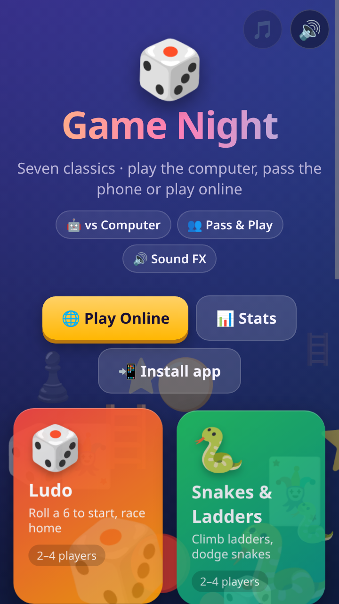
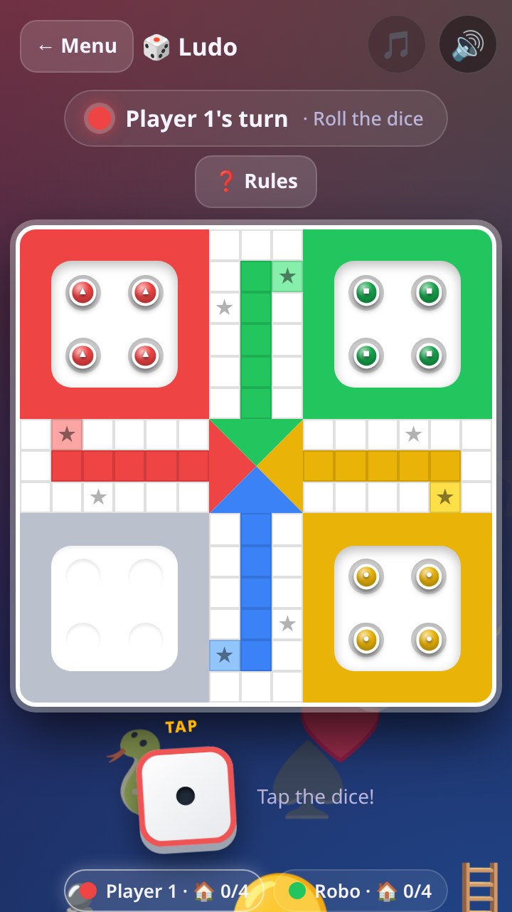
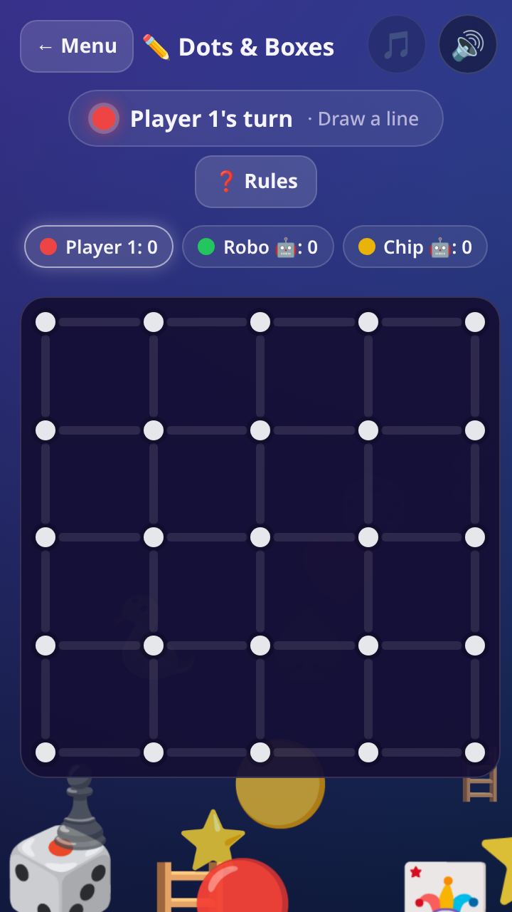

# 🎲 Game Night

[](../../actions/workflows/test.yml)

A game hub in **one HTML file** — no libraries, no images, no build step. Open it in any browser (phone or desktop).
Seven classic games, playable against the computer, by passing the device around, or **online with friends** (with chat and voice).

  

| Game | Players | Notes |
|---|---|---|
| **Ludo** | 2–4 | 15×15 board, safe ★ squares, blocks, hopping tokens, optional extra turns |
| **Snakes & Ladders** | 2–4 | A brand-new random board every game, snakes slide your pawn down their bodies |
| **Tic-Tac-Toe** | 2 | Unbeatable minimax on Hard |
| **Connect Four** | 2 | Falling discs, alpha-beta lookahead AI |
| **Checkers** | 2 | Forced captures, multi-jumps, kings, minimax AI |
| **Crazy Eights** | 2–4 | 52-card deck, wild 8s, optional action cards, "LAST CARD!" call, scores across rounds |
| **Dots & Boxes** | 2–4 | Close a box to score and go again; 4×4 or 5×5 board; Hard AI avoids giving away chains |

## Quick start

```bash
open game-night.html          # or double-click it — it works straight from disk
```

Pick a game → choose **Play vs Computer** or **Pass & Play** → set skill (Easy / Medium / Hard), players and names → **Start**.

### Features

- **Skill levels** for every computer opponent (tested: Hard beats Easy ~19–1 in Connect Four, 30–0 in Dots & Boxes); **game options**
- **Undo** (Tic-Tac-Toe, Connect Four, Checkers), **auto-save & Resume** for every game, per-game **rules sheet**
- **📊 Stats** per game (played / won / lost / draw, best streak) and a 🔥 win-streak line on the winner screen
- **Fair rematches:** who goes first rotates every new game
- **Win tally**, confetti winner screen, **Play Again**
- **Board themes** (Classic, Neon, Pastel), sound effects (Web Audio) with mute, optional background music
- Responsive from 360 px wide, landscape layout, keyboard play, screen-reader turn announcements, colour-blind-safe Ludo tokens,
  honours the system **reduce motion** setting
- Installable app (PWA) with offline single-player, with an "update available" button when a new version is deployed

## Play online

Online play needs the small relay server (zero dependencies, Node 14+):

```bash
cd game-night-server
node server.js                # prints http://<your-ip>:8787 — everyone opens that address
```

Tap **🌐 Play Online** → host creates a room and shares an **invite link** (or the 4-letter code) → friends join → host picks a
game, can **fill empty seats with computer players**, and starts.

- **Chat** (in the lobby and in the game — tap 💬): **text chat** with an unread badge, **emoji reactions** (each plays a sound) and **voice**:
  tap 🎤 once to keep your mic open, tap again to stop — or hold it for push-to-talk. Voice goes out as 3-second clips played one after another.
  Mute any single player (🔈/🔇) or all voices. Voice needs HTTPS or `localhost`.
- **Someone leaves?** A computer player takes over their seat and the game goes on. The host can also remove a player (✕).
- **👀 Watch:** enter a room code and tap Watch to spectate a game that already started.
- **Reconnect:** if your connection drops or you reload the page, your seat is held for 2 minutes and the game catches you up automatically.
- **Stays in sync:** every few moves the devices compare a fingerprint of the game; if one drifts it re-syncs itself automatically.
- **Phone friendly:** the screen stays on during online games and your phone buzzes when it's your turn.

**Limits:** every device holds the full game state, so a determined player could peek at hidden cards (Crazy Eights) with developer
tools — play with people you trust. Voice is short clips, not a live call. Rooms are kept in memory, so a server restart ends them.

## Deploy (Render)

The repo includes `render.yaml`. On [render.com](https://render.com): **New + → Blueprint → pick this repo → Apply**.
Render gives you an `https://….onrender.com` address (HTTPS, so voice chat and "install app" work). Share that address or the invite link.
New pushes to `main` redeploy automatically. The free plan sleeps after ~15 minutes without traffic (first visit then takes ~30 s)
and forgets rooms when it restarts. See [`game-night-server/README.md`](game-night-server/README.md) for other hosting and settings.

## Project layout

```
game-night.html          the whole app (CSS + JS in one file)
game-night-server/       online relay server + its tests + README
game-night-tests/        logic, browser-bot, online end-to-end and phone-emulation tests
.github/workflows/       CI: runs all tests on every push
CLAUDE.md                guidance for Claude Code working in this repo
```

## Tests

```bash
node game-night-tests/logic.test.js           # pure game logic + AI strength (no browser)
node game-night-tests/smoke.js                # a bot plays every game through the real UI in headless Chromium
node game-night-server/server.test.js         # relay server (rooms, reconnect, takeover, spectators, kick, limits, chat)
node game-night-tests/online.test.js          # 1–4 real game clients playing each other through the server (bots, drops, reloads, leave, kick, spectator, desync)
node game-night-tests/mobile.test.js          # phone emulation: real touch taps at 360px, overflow/tap-size audit, PWA + offline
```

The browser tests need Chromium (`CHROME=/path/to/chrome` if it isn't on your `PATH`). `ONLY=Ludo node game-night-tests/online.test.js`
runs just the online scenarios whose name contains "Ludo".

## Adding a game

1. Write `class MyGame extends Game` with a `static meta = { id, name, emoji, tag, min, max, c1, c2, rules, opts? }` and a `start()`.
2. Build your DOM in `this.root`; read `this.players` (`{name, cpu}`), `this.level`, `this.opts`.
3. Call `this.turn(i, 'text')` each turn and `this.finish(title, sub, { winner: i })` at the end.
4. Add the class to the `GAMES` array.

Optional: `serialize()` enables save/resume. For online play, route every human input through `this.ui(kind, ...args)`,
implement `doInput(kind, ...args)` and `wake(seat)` (computer takeover) — see [`CLAUDE.md`](CLAUDE.md) for the rules that keep clients in sync.
`DotsBoxes` is the smallest complete example.

## Ideas for next

Live voice (WebRTC) · server-dealt hidden cards · Backgammon · Battleship · Memory Match · Reversi · more languages

## License

MIT — see [LICENSE](LICENSE).
